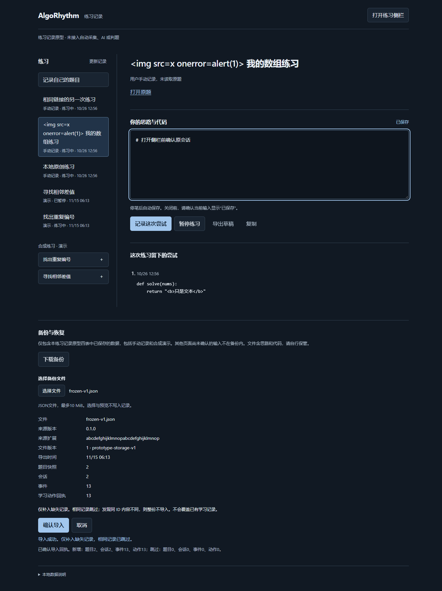

# AlgoRhythm

面向实习与校招的算法学习助手：用户专注思考和练习，系统负责安排、辅导与记录。

**当前有可构建的练习记录原型，尚不是完整学习产品。** 可以手动记录题目，在工作台和侧栏续写、记录尝试、暂停恢复。两道原创合成题保留为演示。旧 demo 已退役，原型没有自动采集、AI 或判题。

当前分支已完成[任务 04](docs/superpowers/plans/2026-10-25-programmer-04-manual-practice.md)范围的手动建题和完整备份验证，交回总架构审查。实际检查与未测项见[本轮验收](docs/verification/2026-10-25-manual-practice.md)和 [STATUS](docs/STATUS.md)，不把手动笔记升级为平台判题或掌握结论。

## 从哪里开始

- [会话续接入口](docs/CONTINUITY.md)：已确认方向与下一步。
- [当前进度](docs/STATUS.md)：实际完成与未验证事项。
- [首版路线](docs/ROADMAP.md)：验证和开发顺序。
- [架构与场景](docs/ARCHITECTURE.md)：主页面关闭后，侧栏如何继续保存。

完整工作台和练习侧栏位于同一个浏览器扩展中，共用一份本地记录。后台处理命令和数据库事务，关闭工作台不影响其他扩展页面保存。任务 01 的 Chromium 与 Chrome 稳定版最小闭环见 [分层验收](docs/verification/2026-10-13-prototype-acceptance-followup.md)，备份规则见 [RFC-01](docs/superpowers/specs/2026-10-14-prototype-backup-restore-design.md)。

日常题目与正式判题仍在力扣。首版完整验收 Python，以可靠资料、按需提示、主动选择讲解和延后练习支撑学习；不做竞赛、排名或社区。

## 运行练习记录原型

使用 Node.js 24 和桌面 Chrome：

```sh
cd apps/extension
npm ci
npm run build
```

打开 `chrome://extensions`，启用开发者模式，选择“加载已解压的扩展程序”，选中 `apps/extension/dist`。点击扩展图标打开工作台，点击“打开练习侧栏”打开原生侧栏。`npm run dev` 监听源码并重新构建；修改后台或清单后需在扩展管理页重新加载。

记录属于同一浏览器配置和扩展 ID。备份仅覆盖本练习记录原型的现有四表，不用于保存唯一一份重要学习资料。“导出草稿”只导出当前文本。

## 记录自己的题目

在完整工作台点击“记录自己的题目”，填写自定标题，可选粘贴力扣中国站题目链接。点击“保存并开始练习”前会先确认当前草稿；失败保留表单和输入。取消不创建记录。侧栏提供工作台入口，不另设建题表单。

标题去首尾空白后最多 200 个 UTF-16 单位；链接只保存规范的题目根地址，不访问、不解析原题，也不自动填标题。没有链接同样可以练习。题目区显示“用户手动记录，未读取原题”，原题链接由用户主动打开。思路和代码只作文本保存，没有结构化判题、自评、代码执行或自动安排。

建题结果未知时保留原命令，点击“恢复上次操作”先查原回执，再决定是否重传；不会用新动作 ID 重建。保存确认后表单关闭，即使后续读取失败也只需“更新记录”。协议版本不匹配时重新打开页面，不清除数据库。契约见 [RFC-03](docs/superpowers/specs/2026-10-25-manual-practice-design.md)。

## 备份与恢复

完整工作台提供“备份与恢复”，侧栏保留打开工作台的入口。任务 04 的验证只使用独立配置里的原创测试记录；[任务 02 验收](docs/verification/2026-10-14-backup-restore.md)保留早期合成原型证据，不代替本轮检查。

1. 点击“下载备份”。先等待当前工作台草稿确认；保存失败则停止，仍可导出草稿。备份是一份已提交快照，不包含其他页面尚未确认的输入。“备份已生成，请确认文件已下载”不表示浏览器已经写到磁盘。
2. 用“选择备份文件”选取 `.json`。本地校验后显示来源版本、导出时间和四表数量；选择或取消都不写库。
3. 核对预览后点击“确认导入”。仅补入缺失记录，相同记录跳过；有一条同 ID 内容不同，整份拒绝。确认前也要等待当前草稿保存，成功后重新读取工作台。其他页面通过“更新记录”读取，不自动切题或覆盖内存草稿。
4. 若结果未知，先核实导入回执。客户端只自动查询一次，不自动重发导入。“核实并重试”先查询，确认没有回执才用原文件、backupId 和摘要重试。刷新后可重新选择原文件核实；导入未确定时不能更换文件或另开一笔导入。

文件为 UTF-8 JSON，最多 10 MiB，可能包含中文思路和 Python 代码；无加密，不自动上传。默认文件 v2、scope=`practice-records-v2`，完整包含手动与合成记录的 problems、sessions、events、actions。继续接受仅有合成历史的 v1 文件 `prototype-storage-v1`，不把旧指纹改为新协议。文件保留已保存草稿、active/paused 会话、事件及成功动作回执；不含诊断、导入回执、配置或 Key，也不含尚未实现的正式提交、帮助、FSRS、计划或模型记录。跨扩展只转换历史指纹中的本地 extensionId。

数据库仍为 v2，本任务没有改六表或索引。布局兼容不代表旧程序理解手动来源；回退须用理解新来源和新备份的修复版本，不删库或自动降库。旧备份决策见 [ADR-0001](docs/adr/0001-prototype-backup-restore.md)，本轮版本兼容以 RFC-03 为准。



```sh
npm test
npm run build
npx playwright install chromium
npm run check:browser
npm run check:backup-browser
npm run check:backup-browser -- --chrome
npm run check:manual-browser
npm run check:manual-browser -- --chrome
```

浏览器检查使用独立临时配置，不使用个人登录档案。默认原型产物在 `apps/extension/output/playwright`，备份在 `apps/extension/output/task02/backup-browser`，手动练习在 `apps/extension/output/task04/manual-browser/chromium` 或同级 `chrome-stable`。本轮新旧脚本结果另归档在 `output/task04/`，分层范围见[任务 04 验收](docs/verification/2026-10-25-manual-practice.md)。

`--chrome` 用已安装 Chrome，从 `chrome://extensions` 官方“加载已解压的扩展程序”（Load Unpacked）入口加载生产构建，目录选择只操作对应测试配置窗口，需要 Windows 上的 PowerShell 7（`pwsh.exe`）。任务 04 已在 Chrome 155.0.8059.85 验证建题、两端续练及跨配置文件恢复；首次加载环境失败单独归档，未放宽加载守卫或关闭沙箱。真实力扣、模型和教学效果尚未验收。

## 文档检查

安装 Node.js 24 后，无需安装项目依赖：

```sh
node scripts/check-docs.mjs
git diff --check
```

CI 检查文档、退役边界、类型、单元测试和扩展构建。浏览器验证结果单独记录，单元测试不代表教学验收。

## 历史与协作

旧源码、截图和开发交接保留在 Git 历史中的 [归档版本](https://github.com/harbinresearcher/algorhythm/tree/archive/demo-before-redesign-2026-10-12)。清理不改写历史，不清除用户浏览器中的题库或 API 配置。详情见 [退役记录](docs/DEMO-RETIREMENT.md)。

贡献前阅读 [CONTRIBUTING](CONTRIBUTING.md) 和 [AGENTS](AGENTS.md)。许可证：[MIT](LICENSE)。
