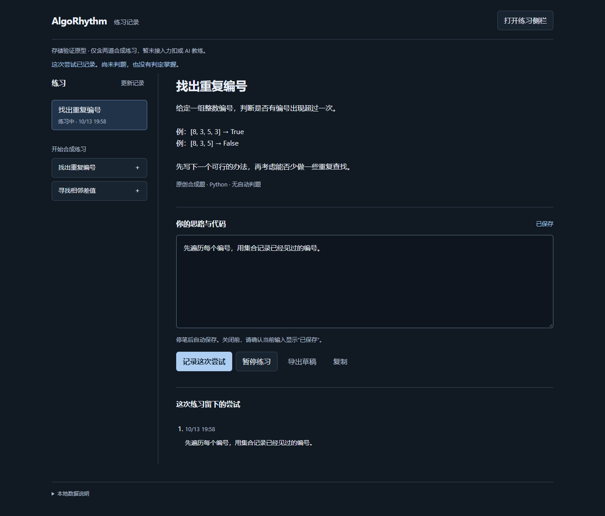
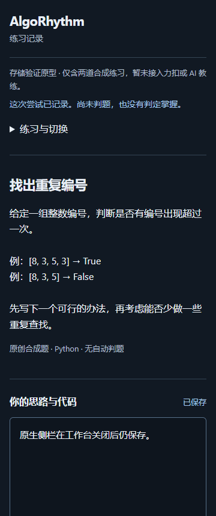

# 扩展存储原型验证记录

日期：2026-10-13。分支 `feat/extension-storage-prototype`。依据 [SC-01 至 SC-11](../superpowers/specs/2026-10-12-extension-workspace-design.md)。以下为实际执行证据，未测边界另列。

本记录保留首次原型验收的历史证据与当时未测边界。本轮复验及 Chrome 稳定版结果另见[后续验收记录](2026-10-13-prototype-acceptance-followup.md)，不以旧通过数代替本轮结果。

## 已执行

- 空存储实现先使 11 项断言失败，补齐实现后通过。
- 空草稿/通信实现先使 7 项断言失败，补齐实现后通过。
- 补原生侧栏 frameId 缺省回归：先失败，再修复通过；历史按 revision 排序，浏览器两条尝试验证先后顺序。
- 来源检查允许非 tab 扩展页面缺省 frameId，仍核对扩展 ID、精确页面路径和可用的 origin。[Chrome MessageSender 说明](https://developer.chrome.com/docs/extensions/reference/api/runtime#type-MessageSender)
- `npm test`：19 项通过；`npm run build`：严格类型检查与生产构建通过。
- Impeccable 检测器扫描 UI：没有机械规则发现。人工截图检查另记，不用这个结果替代。
- 独立审查发现两处问题均已修复，复核无新阻断项。
- 浏览器：Playwright 1.64.0、Chromium 156.0.8078.4、Windows 11 Home China；独立临时配置，13 个检查点成功，页面异常 0。扩展 ID 为 `objgpmalcfljdnfkkifjbhofkcahcbhh`，仅代表该路径下测试安装。
- 截图检查：1360px 工作台与 360px 侧栏；无横向溢出，编辑区 Tab 能进入操作按钮。修复了状态样式误套错误框；收起侧栏导航，保留当前题目。屏幕阅读器实测未完成。

## 场景与证据层次

- SC-01：原生侧栏和标签页形式分别通过。原生上下文经 `chrome.runtime.getContexts` 的 SIDE_PANEL 确认，CDP 连接对应目标，关闭工作台后在原生侧栏输入、保存尝试，重开工作台核对。
- SC-02：真实 worker 经 CDP stopWorker，观察 runningStatus=stopped，再发保存消息；后台恢复、revision 递增、数据保留。
- SC-03：传输丢回执后的查询通过；真实浏览器忽略首次回执再查询/重放只有一条事件。持久化去重先于 revision，内容碰撞被拒绝。
- SC-04：事务末尾 action 写入注入 AbortError，快照/事件/回执整体回滚，同 ID 重试成功。尚未做真实进程在提交中途被杀。
- SC-05：两个并发同 revision 只成功一个。真实双界面从相同版本编辑，第二窗口冲突文本保留，显示重试/导出/显式放弃后读取入口。
- SC-06：题目引用不符拒绝；A 数据不写 B；编辑器销毁后迟到确认不通知新视图。浏览器切题前 flush 并分别检查两题草稿。
- SC-07：关闭再启动同一隔离浏览器配置，原草稿与两条尝试恢复；暂停/恢复也通过。没有模型依赖或调用入口。
- SC-08：模拟配额错误可分类，诊断写失败不递归重试。真实磁盘耗尽/隐私模式尚未实测。
- SC-09：模拟浏览器 sender 的外部站点、未知页面、嵌入帧、其他扩展均被拒绝；无 externally_connectable、content scripts 或站点权限。
- SC-10：单元与真实 runtime 消息均拒绝不兼容版本/实例；UI 说明扩展 ID 数据边界。不同安装 ID 的完整数据迁移未实现。
- SC-11：单元与浏览器都验证 A 保存时输入 B，A 确认不能标 B 已保存；在页面测试层扣住 B 的发送，DB 仍是 A，放行 B 后才变为 B。第二次写入用新 revision；失败保留原动作 ID 与后续文本。

## 运行方法与产物

在 `apps/extension` 运行 `npm test`、`npm run build`、`npx playwright install chromium`、`npm run check:browser`。浏览器脚本使用 Playwright 库控制独立 persistent context，方便停止 worker 与恢复同一临时配置；CLI 普通页面会话不足以覆盖这些生命周期操作。[官方扩展测试方式](https://playwright.dev/docs/chrome-extensions)

`output/playwright/results.json` 记录确切浏览器与扩展 ID；本次合成数据运行结果另存[证据 JSON](2026-10-13-extension-results.json)。原生侧栏未被 Playwright 暴露为普通 Page，脚本用 CDP 连接实际 SIDE_PANEL target 操作其 DOM；不是打开 sidepanel.html 标签页来替代它。测试加载生产包；故障注入留在测试层，不给生产扩展添加调试命令。

合成截图可提交，临时浏览器配置不提交。完整窄屏和冲突截图留在本地 `output/playwright`。

## 验证边界

两道题为本次原创合成素材。未使用真实力扣题干、题解、提交、测试用例、模型 Key 或付费接口。没有证明自动诊断、教学效果、学习安排或完整备份。Chrome 稳定版/Windows 支持矩阵须单独实测，Chromium 测试不能代替它。
