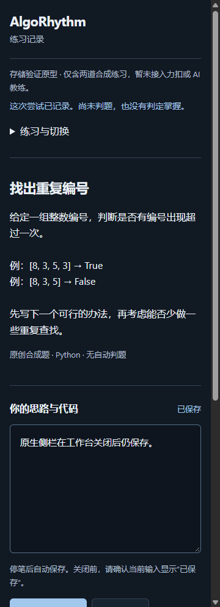

# 程序员任务 01：原型复验记录

运行日期：2026-10-13；交付核对：2026-10-14。分支 `feat/extension-storage-prototype`。任务依据：[程序员任务 01](../superpowers/plans/2026-10-13-programmer-01-prototype-acceptance.md)。

## 基准与范围

基准提交：`a2d97f76acea70825a616c51c23b51afbc49a434`。本轮发布源码、协议 v1、数据库结构、权限、依赖及锁文件均未修改。总架构暂存于 main 的任务单原样复制到此分支；main 的未提交 STATUS 和任务单保留，不纳入此 worktree 的其他改动。

校准场景规格、存储规格和历史验收入口；旧 demo 的 localStorage 明文 Key 描述明确属于已退役实现。首轮记录仍保留在[历史验收](2026-10-13-extension-prototype.md)，本轮不沿用其通过结论。

## 本轮实际检查

环境：Windows 11 Home China；Node.js 26.3.0；npm 12.0.1；Playwright 1.64.0。依赖目录已存在，无需重新安装或升级。

- `npm test`：退出 0；2 个测试文件、19 项测试通过。
- `npm run build`：退出 0；包含严格 TypeScript 检查和生产扩展构建。
- `npm run check:browser`：退出 0；Chromium 156.0.8078.4，13 个检查点通过，页面异常 0。
- 已安装 Google Chrome 稳定版：155.0.8059.40，官方界面加载生产构建后复用相同 13 个检查点，退出 0，页面异常 0。
- 稳定版扩展管理页面的只读安装信息：state=ENABLED；manifestErrors、runtimeErrors、installWarnings、runtimeWarnings 均为空。

`node scripts/check-docs.mjs`：27 份文档、91 个本地引用，0 错误，退出 0；`git diff --check`：退出 0。应用检查、两种浏览器结果、安装摘要和生产文件 SHA-256 保存在[本轮证据 JSON](2026-10-13-prototype-acceptance-followup-results.json)。

## Chrome 稳定版的实际加载方式

显式使用 `C:/Program Files/Google/Chrome/Application/chrome.exe`，不依赖 HKCU App Paths 的另一安装。安装文件与 Google Update 登记版本均为 155.0.8059.40；隔离进程的 `chrome://version` 显示“正式版本”和 `cohort: Stable`。扩展 ID：`objgpmalcfljdnfkkifjbhofkcahcbhh`，只代表当前构建路径和测试安装。

使用新建临时配置，保留浏览器沙箱。先尝试 `--load-extension`，5 秒内没有扩展 worker，未算成功。Chrome 137 已移除此参数；Playwright 官方扩展旁加载范式以其 Chromium 为目标。[Chrome 说明](https://developer.chrome.com/blog/extension-news-june-2025)、[Playwright 说明](https://playwright.dev/docs/chrome-extensions)。

随后从 `chrome://extensions` 打开开发者模式，点击本机实际显示的“加载未打包的扩展程序”。Playwright 没有收到原生目录选择器的 filechooser 事件；用 Windows UI Automation 操作本轮临时配置所属 Chrome 窗口，选择已核实的 `apps/extension/dist`。Windows PowerShell 5.1 未取得选择控件；已有 PowerShell 7.6.5 成功完成选择。没有修改个人配置、系统策略，也没有使用 unsafe 调试开关或关闭沙箱。

加载后沿用 `scripts/browser-check.mjs` 的既有断言。临时驱动只改变已安装浏览器、官方加载步骤与产物目录；它们保留在忽略的 `output/task01`，不成为发布代码。第二次启动仍用同一测试配置，直接读取已安装扩展和已保存记录。[官方加载方式](https://developer.chrome.com/docs/extensions/get-started/tutorial/hello-world)。

## 稳定版最小闭环及独立复验步骤

从锁文件构建：在 `apps/extension` 运行 `npm ci`（仅依赖缺失时）、`npm test`、`npm run build`。Chromium 自动回归仍用 `npm run check:browser`；该命令本身不能当作稳定版检查。

Chrome 稳定版可用全新测试配置，在官方扩展页面加载此构建，然后按以下固定操作复验。不得选个人登录配置；测试配置与构建目录始终保持同一份。

1. 点击扩展图标打开工作台，开始“找出重复编号”，输入“先遍历每个编号，用集合记录已经见过的编号。”；确认已保存后记录第一次尝试。
2. 从工作台打开原生侧栏，关闭工作台。在侧栏输入“原生侧栏在工作台关闭后仍保存。”并记录第二次尝试。重开工作台，核对草稿和两条尝试，较新的记录排在前。
3. 暂停、恢复；关闭整个测试浏览器，重开同一测试配置。核对最后确认的草稿与两条尝试，没有自动请求模型。
4. 两界面先读取同一会话版本。第一界面保存“第一窗口已保存”；第二界面输入“第二窗口未保存，必须保留”。第二界面应显示版本冲突并保留该文本。

本轮的原生侧栏通过 `chrome.runtime.getContexts` 的 SIDE_PANEL 和 CDP target 验证。另行检查过标签页中的侧栏 HTML，两者没有混记。浏览器重启及冲突断言通过。工作台、侧栏、窄屏与冲突截图保存于下述产物目录；这里附一张本轮稳定版原生侧栏截图。



## SC-01 至 SC-11 的证据层次

Chromium 列指 156.0.8078.4；Chrome 稳定列指 155.0.8059.40。表内只标实际覆盖的部分，不表示整个 SC 或正式产品验收完成。

```text
┌───────┬────────────────┬──────────────┬──────────────┬──────────────────┐
│ 场景  │ 单元/模拟      │ Chromium     │ Chrome 稳定  │ 未验证           │
├───────┼────────────────┼──────────────┼──────────────┼──────────────────┤
│ SC-01 │ 来源校验       │ 关闭后续存   │ 关闭后续存   │ —               │
│ SC-02 │ 重开数据库     │ 后台停启     │ 后台停启     │ —               │
│ SC-03 │ 丢回执查询     │ 查询与重放   │ 查询与重放   │ 真实连接中断     │
│ SC-04 │ 事务故障注入   │ 未测         │ 未测         │ 提交中途杀进程   │
│ SC-05 │ 并发版本冲突   │ 双界面冲突   │ 双界面冲突   │ —               │
│ SC-06 │ 引用隔离       │ 切题前保存   │ 切题前保存   │ 迟到平台/模型    │
│ SC-07 │ 重开数据库     │ 浏览器重启   │ 浏览器重启   │ 异常退出组合     │
│ SC-08 │ 配额/诊断失败  │ 未测         │ 未测         │ 真实配额/权限    │
│ SC-09 │ 伪造 sender    │ 未测         │ 未测         │ 真实不可信来源   │
│ SC-10 │ 版本/实例拒绝  │ 运行时拒绝   │ 运行时拒绝   │ 完整数据迁移     │
│ SC-11 │ 代次/延迟确认  │ A/B 确认     │ A/B 确认     │ 未确认关闭组合   │
└───────┴────────────────┴──────────────┴──────────────┴──────────────────┘
```

SC-03 的浏览器检查忽略已提交响应后查询并重放；真实连接中断仍未制造。SC-04 仅有事务末尾 AbortError 注入；没有杀死提交中的真实进程。SC-08 只有模拟配额失败和诊断写失败，没有耗尽磁盘、实测权限拒绝或隐私模式。SC-09 使用单元构造 sender；没有接入内容脚本或真实攻击页面。SC-06 只验证合成草稿、引用与切题前 flush；平台判题和模型反馈尚未实现。SC-07/11 的异常退出及未确认输入组合仍未穷举。

## 产物与剩余边界

本地原始产物相对 `apps/extension`：

- `output/task01/unit-tests.log`、`build.log`、`browser-regression.log`。
- `output/playwright/results.json`、`workspace.png`、`native-panel.png`、`panel-360.png`、`conflict.png`：本轮 Chromium。
- `output/task01/chrome-stable/results.json`、`install-info.json` 及同名截图：本轮稳定版。
- `output/task01/chrome-flag-probe.json`、`chrome-stable.log`、`stable-install-info.log`：加载尝试和最终成功操作记录。

仓库只收录合成证据 JSON、原生侧栏截图和必要文档；临时配置、工具驱动和日志不提交。没有新增产品功能或发现需要修改发布源码的局部缺陷。

Chrome 稳定版最小闭环本轮已通过；不等于最低声明 Chrome 116 或其他版本均已支持。SC-04/08/09 的上述剩余边界仍是正式发布前门槛。完整 schema、备份/迁移、真实力扣、模型、FSRS、屏幕阅读器和学习效果均未验收。原型不能保存唯一一份重要学习记录。交付后等待总架构审查，未启动后续任务。
