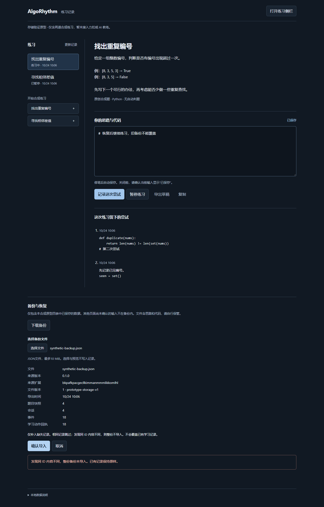
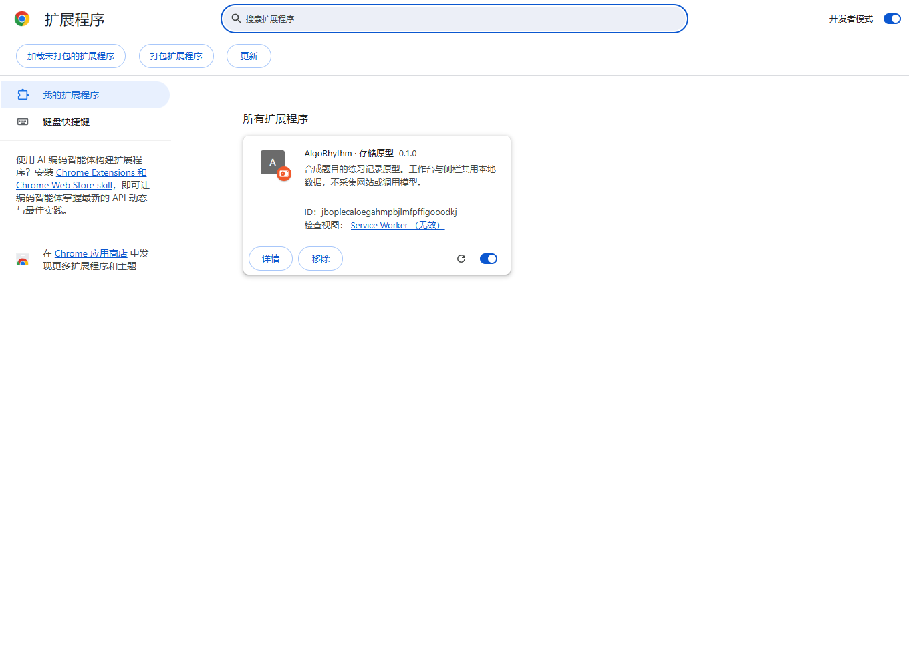

# 程序员任务 02：合成原型备份与恢复验收

任务日期：2026-10-14；实现与 RED/GREEN：2026-10-14/15；最终复验：2026-10-24（Asia/Shanghai）。基准提交 `f2f3e3f1a4a999803a1ce1a67336628980a7ac68`。依据[任务单](../superpowers/plans/2026-10-14-programmer-02-backup-restore.md)、[RFC-01](../superpowers/specs/2026-10-14-prototype-backup-restore-design.md)与[ADR-0001](../adr/0001-prototype-backup-restore.md)。

## 当前结论

实现与本任务范围验收完成，交回总架构审查。2026-10-24 重新运行全量 179 项测试、类型检查、生产构建、原型浏览器回归 13 项、新增 Chromium 主检查 13 项（含另 10 项 UI 边界），以及 Chrome 稳定版主检查 10 项，均退出 0，页面异常均为 0。单元、fake-indexeddb、真实 IndexedDB 和页面注入的传输故障分别报告。不是正式发布批准。

范围仅为合成原型的 problems、sessions、events、actions。备份文件版本 1，scope `prototype-storage-v1`；数据库版本 2，仅新增 backupImports。诊断、配置、Key、未确认输入不进入文件。未实现正式领域、力扣、模型或 FSRS 备份。

任务单、RFC、ADR、任务 01 总架构验收从主目录逐字复制，SHA-256 对照一致。主目录未提交文件与原型分支保留；本次使用独立工作树 `feat/prototype-backup-restore`，不向 #14 追加功能。

## 测试过程与证据位置

本轮按锁文件安装依赖，先重新运行原 19 项测试和生产构建，均退出 0。没有升级依赖或借用旧 demo 结果。

行为失败证据与最终运行日志保存在 `apps/extension/output/task02/`：

- `pure-red.log`：纯校验 57 失败、4 通过；完整实现与新增边界后的核心结果见 `core-final-2026-10-15.log`。
- `core-red-2026-10-15.log`：事务行为 16 失败、73 通过；随后核心测试 95 项通过。
- `migration-red-20261015.log`：缺少 v2 表时 3 失败、1 通过；迁移与来源新增 18 项，连同原 19 项回归共 37 项通过。
- `handler-red-2026-10-15.log`：消息入口 12 项行为失败；`handler-green-2026-10-15.log` 12 项通过。
- `client-red-behavior-2026-10-15.log`：28 项行为失败；`client-green-2026-10-15.log` 28 项通过。
- `ui-time-red-behavior-2026-10-15.log`：合法安全整数超出 Date 范围时的失败；`ui-time-green-2026-10-15.log` 3 项通过。保留协议范围，界面显示原 epoch 毫秒并省略无效 ISO 属性。
- `browser-red-2026-10-15.log`：真实 Chromium 加载旧生产构建，在找不到“备份与恢复”标题处失败。UI 实现前已记录，未用数据库版本断言代替入口失败。

部分早期迁移和浏览器日志最初生成于仓库根 `output/task02/`，原文件保留，并复制到上述统一目录。missing-module 失败单独保留，不作为行为 RED 证据。

独立审查在真实 Chromium 发现两份各自合法的文件可能在合并后破坏关系：共用题目快照但换会话 ID，或保留会话而换整套事件/动作 ID。原实现仅比较同 ID 行，错误地确认成功，随后导出失败。`union-relations-red-2026-10-15.log` 记录两项行为失败（95 项原核心用例通过）；随后补动作身份冲突和合法部分记录恢复测试，核心最终 99 项通过。修复在五表事务内复核受影响快照所有者、事件与动作身份，不对整个目标库套单份文件上限。独立复核及最终 Chromium 均证明两种关系冲突整份拒绝、五表不变、之后仍能导出。179 项最终结果覆盖本修复，修复前 175 项只作过程记录。

## BK-01 至 BK-11 对照

- BK-01：Store 生成两个会话的固定合成 fixture，包含 active/paused、中文、Python、已保存但未记录尝试的草稿和多次尝试。单元测试和真实 Chromium 均完成导出、独立空配置跨扩展 ID 导入、实际下载后重导出；规范化目标动作指纹后四表相等，并逐项查询原动作回执。
- BK-02：单元与真实 Chromium 均验证重复同文件不增事实；继续保存后重导入仍返回原回执，新草稿保留。单元另外验证并发同文件和同 backupId 改摘要拒绝。
- BK-03：模拟与真实 Chromium 均验证同 ID 冲突整份拒绝，其他独立新会话与成功回执也不补入；另实测两种跨 ID 关系冲突。单元验证独立会话允许补入、相同行跳过与部分历史补齐。预览后外部写入及导入最后阶段排入独立事务有模拟断言，未称为人为卡住真实浏览器事务。
- BK-04：严格 JSON/schema、格式/版本/scope、未知字段、记录数/UTF-8 字节、重复 ID、引用与 revision、状态/命令/事件/回执链、摘要分别断言错误类别。校验纯计算，不触发学习命令。SHA-256 有独立计算的固定期望。
- BK-05：fake-indexeddb 最后回执 add 分别注入 AbortError、QuotaExceededError、SecurityError，四表与回执全部回滚，同文件可重试。未制造实际磁盘耗尽或浏览器权限撤销。
- BK-06：客户端严格响应、30 秒超时、首次只查询和手动先查均有单元断言。真实 Chromium 中事务已提交后由页面模拟丢 ACK，只查一次就恢复；真实停止/重启 worker、关闭/重开整个目标浏览器后仍查询到原回执和续练草稿。UI 注入发送前拒绝并真实查询 null，保持未知锁定，手动按 import/query/query/import 恢复；不称为真实物理断线。
- BK-07：模拟并发读写只得到完整前态或后态，WebCrypto 在事务外。模拟和真实 Chromium 导出均过滤植入系统/诊断哨兵并保留学习文本；不声称已实测浏览器线程级并发快照竞态。
- BK-08：单元与真实 Chromium 跨扩展 ID 恢复均只转换动作路由；四表内容、原动作查询、规范化同命令重发、篡改命令与旧实例直接消息均有断言。目标扩展 ID 来自临时生产构建原样副本，不改 manifest key 或权限。
- BK-09：模拟和真实 IndexedDB 均从旧 v1 五表布局出发。真实升级前由测试工具在同一只读事务保存四表；worker 原生升级事件注入 abort 后数据库仍为原生版本 10，五表与诊断保留；真实后台重启后生产 Store 升为 20，再用按钮下载对照四表一致。显式低版本请求返回 VersionError 且库不变。旧 Dexie 重开限制见下节。
- BK-10：真实 Chromium 实测下载、文件预览/取消/确认、非法文件/版本、冲突提示、刷新续练与原生侧栏保存。串行 UI 脚本另验 10 项：flush 成功才导出、失败不请求不下载、未知结果锁定、成功后刷新失败仍保留成功、text/hash 取消/换文件迟到失效、读取前 10 MiB 限制、合法超 Date 时间可预览/恢复及空选择不自动切题。页面注入仅在测试配置中，不入发布包。截图已查看，状态、冲突和恢复按钮可读；键盘仍保留原生 file input/button，原型回归含键盘进入动作区，不宣称屏幕阅读器验收。
- BK-11：单元覆盖侧栏、网页、其他扩展、子框架与伪造角色。真实 Chromium 原生 SIDE_PANEL 三个备份消息均 FORBIDDEN，学习保存仍可用；本机普通网页没有外部消息授权，实际装载的 workspace 子框架三条管理消息均 FORBIDDEN，五表不变。未给产品新增 externally_connectable 或其他攻击测试入口。其他扩展与未来内容脚本仍只有来源单元证据，未宣称整个 SC-09 矩阵完成。

## 最终命令与浏览器产物

2026-10-24 在 `apps/extension` 运行 `npm test`、`npm run build`、`npm run check:browser`、`npm run check:backup-browser`，均退出 0。前两项日志为 `output/task02/final-tests-2026-10-24.log`、`final-build-2026-10-24.log`。原 13 项日志为 `original-browser-2026-10-24.log`；新增主检查为 `backup-browser-chromium-2026-10-24.log`。新增脚本会在关闭三个主配置后串行运行 `scripts/backup-ui-boundaries.mjs`，子脚本失败也会使主命令失败。

Chromium 156.0.8078.4；Windows 11 Home China；Node 26.3.0、npm 12.0.1、Playwright 1.64.0。原型结果在 `output/playwright/results.json`，新增结果及三份实际下载文件在 `output/task02/backup-browser/chromium`，子检查在 `output/task02/ui-boundaries`。这些配置和产物均被 Git 忽略；只归档脱敏摘要和合成截图。

## Chrome 稳定版

2026-10-24 实测 Google Chrome 155.0.8059.85。`npm run check:backup-browser -- --chrome` 第四次完整执行退出 0，10 项主检查通过，页面异常 0；日志 `output/task02/backup-browser-chrome-stable-attempt-4-2026-10-24.log`。使用独立临时配置，从 `chrome://extensions` 开启本测试配置的开发者模式并点击官方 Load Unpacked；PowerShell 7 UI Automation 仅操作完整 user-data-dir 匹配的测试 Chrome，核对当前 dist 或原样副本的全部文件与 SHA-256。保留沙箱，没有移除安全机制、增加权限或读取个人配置。

实际完成下载、多会话/中文/Python/草稿/尝试、另一个空配置跨扩展 ID 导入与回导、原动作查询和去重、刷新续练、重复原文件不覆盖、冲突整份拒绝、取消/非法文件无写、真实 worker 停启与整个浏览器关闭重开、原生侧栏拒绝管理消息但学习保存可用。真实旧 v1 库的工具快照、升级 abort 后保留、后台重启再升 v2 及按钮下载比对也通过。稳定版未重复 Chromium 的两个关系派生文件和 10 项页面注入 UI 子检查；不能将两种浏览器的检查数相加当成同一套用例。

失败尝试分别保留：前两次 UI Automation 未找到目录选择器，未进入产品流程；第三次已通过最小恢复闭环，但驱动重开配置时在打开工作台前等待休眠 worker，15 秒超时。最终驱动复用此前同一配置已核实的扩展 ID，先打开工作台，由正常 runtime 消息唤醒后台。只修改测试顺序，未改产品。前两次选择器间歇失败根因未确定；增加 UTF-8 输出和限定窗口诊断后后续加载成功，不能声称这些诊断修复了选择器本身。

成功后只重开本任务目标测试配置，读取官方安装信息：state=ENABLED，manifestErrors、runtimeErrors、installWarnings、runtimeWarnings 均为空。截图已查看；后台空闲不要求常驻，已在完整重开流程验证后续消息可唤醒。

脱敏结果、各下载文件摘要与 9 个生产文件的 SHA-256 见[结果 JSON](2026-10-14-backup-restore-results.json)。最终归档逐一复算两种浏览器实际下载文件的摘要，均与运行结果一致；不提交这些学习文件、浏览器配置或完整请求日志。

## 升级与回退限制

Dexie 逻辑版本 1/2 对应原生 IndexedDB 版本 10/20。原五表定义和索引未改，只有 backupImports 加表；升级失败没有删除、重建或降库兜底。

锁定的 Dexie 4.4.6 在显式低版本打开收到原生 VersionError 后，会尝试不带版本重开。因此旧 v1 定义可以打开本次只加表的 v2 库；模拟测试已刻画这一事实，不能宣称旧程序必然停止。原生低版本请求的 VersionError 与旧 Dexie 的兼容重开分开报告。该行为不授权回退旧程序，也不提供自动降库。正式修复须保持 v2 兼容，或在独立配置验证导出恢复。

## 未测试与交付边界

仍保留任务 01 的 SC-04/08/09 发布缺口：真实事务中途杀进程、实际配额/权限故障、隐私模式和完整不可信来源矩阵。任务 02 的浏览器来源隔离不能自动覆盖未来 content script 或真实平台接入。最低声明 Chrome 116、其他版本、屏幕阅读器、异常退出与未确认输入组合未穷举。

备份关系和摘要不证明作者身份、平台判题或掌握情况。仅允许合成测试库，不读取个人配置或实际学习备份。PR 交回总架构审查，不合并，不启动后续功能。
