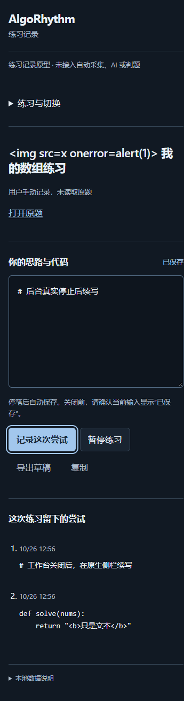

# 程序员任务 04：手动建题与完整备份验收

任务日期：2026-10-25；本轮实施与检查日期：2026-10-26。依据[任务单](../superpowers/plans/2026-10-25-programmer-04-manual-practice.md)、[RFC-03](../superpowers/specs/2026-10-25-manual-practice-design.md) M-01 至 M-06。独立分支 `codex/task-04-manual-practice`，工作树 `manual-practice`，基准 `31e25081d3219d05070857841ca299461867335d`。未改总架构目录及旧实现工作树。

## 当前结论

实现提交 `40fe26d7e93e49266537c4bab149af4a97044647` 已推送，[独立 PR #25](https://github.com/harbinresearcher/algorhythm/pull/25) OPEN、非草稿、未合并；base 为尚未合并的 `codex/task-04-definition`。本交回元数据另作 docs 提交；最新 head 与 CI 按 PR 核对，不将实现提交的旧检查冒充最终 head 的检查。

任务 04 范围实现及本轮验证完成，交回总架构审查，未合并。备份全量测试和构建通过后，才开放建题表单。最终 367 项、类型检查与构建通过；原型 Chromium 13 项、备份 Chromium 主检查 14 项及 UI 边界 10 项、手动练习 Chromium 20 项及 Chrome 稳定版 10 项通过。这里的浏览器项是脚本检查点数，不是底层断言数；手动 Chromium 20 项中 8 项含受控故障注入，稳定版只跑真实主流程。

没有采集、AI、判题、FSRS、题干导入或任务 03 关联模块接入。用户手动笔记不升级成平台事实，真实准入仍 unresolved。可核对的版本、产物及下载 SHA-256、检查点和证据边界见[结果摘要 JSON](2026-10-25-manual-practice-results.json)。

在线协议 2；数据库布局仍为 2、原六表与索引不变；默认备份格式 2/scope=`practice-records-v2`，继续导入冻结的格式 1/scope=`prototype-storage-v1`。扩展清单只改版本为 0.2.0 和说明，权限、CSP、内容脚本及 host 权限未增加。

## 顺序与失败到通过证据

本轮按锁文件安装依赖，没有升级包。本地 Node.js 26.3.0、npm 12.0.1；CI 仍按仓库配置使用 Node.js 24，不将本地版本混称 CI 环境。基线 `npm test` 为 8 个文件、272 项通过；`npm run build` 含类型检查通过。日志在 `apps/extension/output/task04/baseline-tests-2026-10-26.log`、`baseline-build-2026-10-26.log`。

1. 修改在线协议前，将原 `protocol.ts` 原文复制为 `legacy-protocol.ts`。Windows 工作副本 SHA-256 为 `edd7e82525b47d012c437e5c7d0880d58c85d228d6f07f16be9379f788f051d0`；Git 规范行尾后的 blob 为 `7d0cf597acd8e164ebc406d311229eb077de79df`，与基准原 protocol 完全相同，不批量升版旧 v1 字面量。原 backup-v1.json 无差异，规范摘要 `b1827a2f8d7010ea02b28517a22d727132ccc6b90f0b21bbe9572498ad022b7f` 保持。
2. `manual-practice.test.ts` 新增 57 项，先见 57 项行为失败，之后 57 项通过。包含合法 URL、原字符串绕过、标题 UTF-16 边界、四表回滚、碰撞、来源及旧库续练。锁定 Zod 的字符串 max 不等同 RFC 要求的 UTF-16 限制，已用共享显式长度守卫；100 个 emoji 允许，多一单位拒绝。日志 `manual-red-2026-10-26.log`、`manual-green-2026-10-26.log`。
3. 新备份初轮 32 项先见 27 失败、5 通过，再通过；补 4 项 legacy 非 start 动作不能作用于 manual 的反例，移除来源守卫时 4 项均失败，恢复后新备份 36 项通过。日志 `task04-backup-v2-red.log`、`task04-backup-v2-legacy-red.log`、`task04-backup-v2-green.log`。部分早期日志原在应用 `output/task04-backup-*`，原文件保留并复制到 `output/task04/`。
4. 备份完成后本轮全量 10 个文件、367 项通过：原 272 项行为保留，新建题 57、新备份 36、原备份文件新增 2 个兼容用例。`backup-gate-tests-2026-10-26.log` 与 `backup-gate-build-2026-10-26.log` 均退出 0。阶段中的测试类型推宽问题单独修正，没有把编译失败当行为 RED。
5. UI 接入前真实 Chromium 加载该生产构建，等待“记录自己的题目”按钮超时，退出 1，见 `manual-ui-red-2026-10-26.log`。UI 接入后全量仍 367 项通过，类型检查和构建退出 0，见 `ui-gate-tests-2026-10-26.log`、`ui-gate-build-2026-10-26.log`。
6. 浏览器结束后再次全量检查，10 个文件、367 项及类型检查/构建均退出 0，见 `final-tests-2026-10-26.log`、`final-build-2026-10-26.log`。128 个模块、9 个发布文件与浏览器检查所用构建逐项 SHA-256 相同。最后只澄清浏览器脚本结果标签和 notes，没有改流程、断言或产品代码，不为文案重跑矩阵。

上述测试数按 Vitest 用例计，不把内部循环、历史通过数或独立探针次数额外累加。新 backup-v2 fixture 由真实 Store 原创命令生成，含 5 个会话/快照、13 个旧 v1 与 8 个新 v2 动作；没有复制真实平台题干、题解、用户提交或浏览器资料。

根目录 `node scripts/check-docs.mjs`：44 份文档、181 个本地引用、0 错误；`git diff --check`、三个变更浏览器脚本的 `node --check` 均通过。后续 PR 元数据更新若增加链接，以最终检查结果为准。

## MP-01 至 MP-10 对照

- MP-01：本地规范化和 Store 测试已通过。有/无链接、标题 trim、1–200 UTF-16、默认 443、query/hash 清理；拒绝 HTTP、伪造主机、userinfo、非默认端口、编码/点段/反斜线/控制字符和不允许路径。服务器只接受规范结果，不静默改指纹。两浏览器实际有/无链接建题成功，无链接流程用键盘完成；Chromium 补空/超长标题、恶意链接与未知字段拒绝、取消不写库。
- MP-02：真实 Store + fake-indexeddb 验证 started/revision=0/空草稿、manual 来源及四表各一行。同动作去重、换标题/URL 碰撞；最后 actions.add 注入 AbortError、QuotaExceededError、SecurityError 时四表回滚且可重试。注入不代表真实磁盘或权限故障。
- MP-03：Store 后续 saveDraft、attempt、pause、resume 保持来源与原状态规则。两浏览器均在原生 SIDE_PANEL 上下文续写/记录尝试，关闭工作台后保存，CDP 确认 worker 停止后唤醒保存，整浏览器关闭重开后恢复；目标配置恢复后也再次重启保留记录。
- MP-04：建题表单复用 guarded、DraftController.flush 与原 pending/queryAction。Chromium 限定页面传输注入 flush 失败、发送前丢失、已提交 ACK 丢失、读取失败、迟到 A/B 和延迟 ACK 双击；断言保留输入、先查回执、重传原 payload/全部 ID、只创建一个会话、B 确认前不建题、已提交后关闭表单且无重建入口。真实两页面 revision 冲突保留本地文本。上述传输/迟到均为模拟，事务与 UI 交互是真实浏览器。
- MP-05：两浏览器同 URL 两次建题生成不同会话，草稿与尝试隔离；HTML 样式标题和笔记只显示文本，链接安全属性断言通过且没有点击链接。来源固定 manual-user-v1、题干为空。监听期间未观察到产品外部请求，监控窗口限制见下文。
- MP-06：冻结 synthetic 四表读入后用 v2 续练，旧 action 指纹及回执不变；v1 原命令在线拒绝，v2 queryAction 可查旧结果。v2 start 不接受 manual；legacy schema 不接受新在线消息或 startManual。Chromium 用受控旧页面信封获得真实 v2 后台拒绝，UI 提示重开、不把旧库当空库；这是消息注入，不是旧 v1 二进制。冻结 legacy schema 拒绝 v2 消息有单测，旧 v1 后台和二进制未运行，未声称旧包可兼容 manual。
- MP-07：v1 导入、原摘要与回执查询、新格式默认导出、混合 v1/v2 重放、恢复后续练、重导旧文件不回退均有单测。两浏览器实际从按钮下载 v2，在另一空临时配置和不同扩展 ID 恢复；比较归一后的四表及所有旧/新指纹，续写、尝试后重导不回退。源/目标下载的大小和摘要见结果 JSON。
- MP-08：单测覆盖 v2 来源、title/URL 指纹、事件归属、legacy 动作作用 manual、无主引用和跨文件所有者矛盾拒绝；错误版本及 scope 交叉组合拒绝。两浏览器将非法文件交 UI 本地预览拒绝、五表不变，没有声称这些用例都到达后台。原备份 Chromium 脚本另外实际发送跨文件快照独占/同会话历史冲突，整份后台拒绝且五表不变。沿用五表原子事务，不裁剪或覆盖。
- MP-09：混合指纹按对应协议只规范化 extensionId。成功 receipt 优先，即使续练后仍返回原结果；跨格式同 backupId 不同摘要碰撞有单测。两浏览器真实跨 ID 恢复、续写后重导不回退。原备份主检查与 UI 边界重跑，覆盖哨兵不导出、取消、10 MiB、预览迟到、未知结果先查及非授权来源。未知 ACK/读取失败是限定模拟，不是真实断电。无个人记录、Key、日志或配置入库/备份 fixture。
- MP-10：Chrome Stable 155.0.8059.85 主流程 10 项通过，Chromium 156.0.8078.4 手动流程 20 项通过；实际建题、两端保存、关闭/重启、下载/跨配置恢复分别断言。两浏览器查看桌面/360px 截图，键盘与无横向溢出通过。只使用独立临时配置和原创记录，没有访问原题网站或自动提交。

MP-02 的最后回执失败另在 Chromium worker 限定注入一次 IndexedDB 写入错误，四表真实回滚；这仍是注入故障，不证明真实配额或磁盘错误。各 MP 合并单测和分层浏览器证据，不把 20 个检查点称为每一条款的真实浏览器穷举。

## 浏览器命令、产物与观察范围

2026-10-26 在 Windows 11 Home China、隔离临时配置运行，以下命令均实际退出 0。日志均位于 `apps/extension/output/task04/`，生产包未增加测试故障入口。

- `npm run check:browser`：13 项，`original-browser-2026-10-26.log`；结果归档 `original-browser-2026-10-26/results.json`。
- `npm run check:backup-browser`：14 项（含新增冻结 v1 导入/回执查询/v2 导出检查点），串行 UI 边界 10 项；`backup-browser-2026-10-26.log`，结果分别在 `backup-browser-2026-10-26/`、`backup-ui-boundaries-2026-10-26/`。
- `npm run check:manual-browser`：20 项；`manual-browser-chromium-2026-10-26.log`、`manual-browser/chromium/results.json`。
- `npm run check:manual-browser -- --chrome`：10 项；`manual-browser-chrome-stable-2026-10-26.log`、`manual-browser/chrome-stable/results.json`。使用官方 Load Unpacked，保留沙箱；加载 helper 的临时目录、发布文件 SHA、配置 PID 与官方选择器守卫未放宽。

各结果 errors 数组为空，只表示 Playwright 页面未捕获异常为 0；未完整订阅原生侧栏和 worker 的 Runtime 异常。手动流程 context request/page websocket 与额外 worker CDP 监听期间，未观察到 HTTP/HTTPS/WebSocket 请求。CDP 首次挂接前、重启后重新挂接前不在观察窗口内，不能称为浏览器整个生命周期绝无请求。产品 CSP 仍为 `connect-src 'none'`，源代码无采集或请求逻辑。原备份 BK-11 单独使用本机 `127.0.0.1` 合成工具页验证非授权来源，其 HTTP 与产品网络观察分开。

首次稳定版在官方目录选择阶段失败：`Official isolated test chooser missing`，尚未开始产品闭环。失败结果保存在 `manual-browser/chrome-stable-loader-attempt-1-2026-10-26/` 及同名日志。未查明根因；新隔离配置重试后上述 10 项通过，不声称修复系统选择器。备份本机来源探针的中间尝试保存在 `backup-browser-data-attempt-2026-10-26/`，不作为最终正式证据。

原始日志、临时配置、下载和结果留在忽略的 output 目录，不提交浏览器资料。仓库仅提交合成截图、摘要、SHA 和验收说明。

## 只读复核

阶段性独立核心/备份和 UI 审查、最终只读复核未发现阻断。实际阅读范围包括严格 manual 规范化和来源 union、旧协议冻结、Store 同事务/幂等/快照推源、备份版本分派/来源链回放/原摘要后 extensionId 归一/五表事务及并集约束，以及 UI 先 flush 再建题、unknown 原命令、committed/read 分离、取消和缺快照。最终文档复核还对照原始结果与脚本，修正键盘流程和 legacy schema 验证措辞；没有把只读审查计为单测或真实浏览器通过数。

## 保留边界

仍不是正式发布或学习效果验收。真实配额/权限故障、事务中途杀进程、隐私模式、完整浏览器支持和来源矩阵未穷举。数据库布局兼容不代表旧程序理解新来源；正式回退须理解在线 v2/备份 v2，不能降旧包后清库。任务 03 合成关联仍独立，不赋予手动内容平台可信度。

完成本任务范围后交回独立 PR，等待总架构审查；不合并，不联系平台，不启用采集、模型或任务 05。
